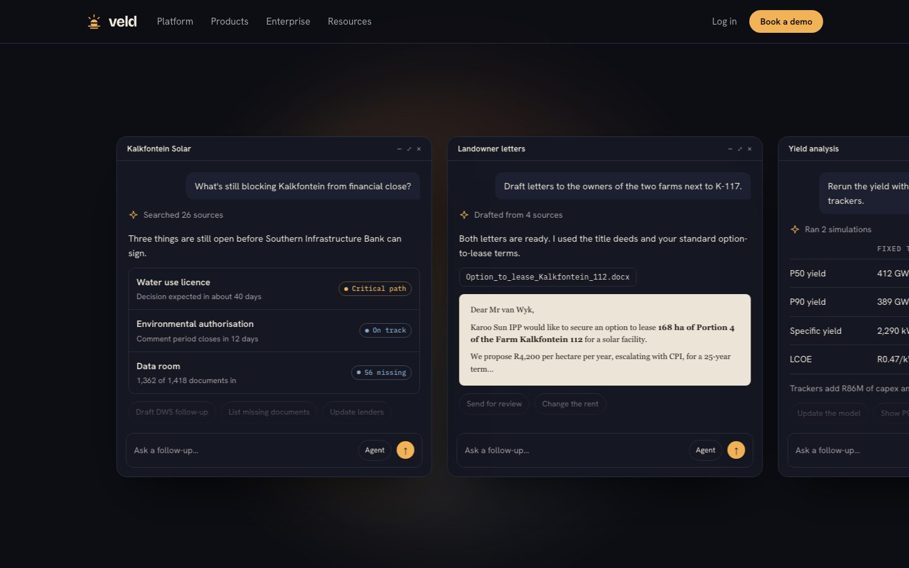
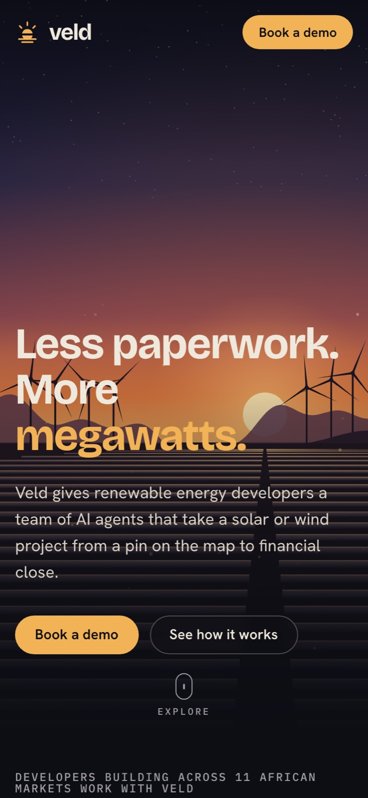

# Veld: a landing page for a company that doesn't exist

**Live site:** https://veld-five.vercel.app
**Role:** concept, story, visual design, front-end build
**Stack:** one HTML file, plain CSS and JavaScript, Canvas 2D. No framework, no build step, no dependencies.

> Veld is fictional. The company, customers, people, lenders and most numbers are invented for this project. The one real statistic is linked to its source.

## The brief

I gave myself a brief: build a marketing site at the level of [lev.com](https://www.lev.com), a commercial real estate AI company, but for a company I invent. Lev's site does a lot with very little. It has one strong headline over a cinematic photo, one product story told in stages, then proof and a call to action. I wanted to see whether I could make that structure work for a different industry with its own visual identity, without copying Lev's look.

## Finding the story

I studied Lev's homepage section by section. Its pitch is "Do less work. Close more deals." The idea underneath is that AI agents handle the paperwork that slows down a deal, from sourcing through screening and execution to close.

I looked for an industry where that idea is just as true but has more at stake. I landed on utility-scale renewable energy in Africa. The [IEA's Africa Energy Outlook 2022](https://www.iea.org/reports/africa-energy-outlook-2022) puts it plainly: Africa has 60% of the world's best solar resources and only 1% of its installed solar capacity. The gap is mostly not engineering. It's site studies, environmental permits, grid connection queues and lender data rooms, and each of these can take years.

That gave me the company and the headline:

**Veld** (Afrikaans for open grassland) gives renewable energy developers a team of AI agents that take a solar or wind project from a pin on the map to financial close.

**"Less paperwork. More megawatts."**

The page tells that story in order:

1. **Hero:** the promise, set over the landscape the product works in.
2. **The gap:** the real 60% / 1% statistic, then the four delays developers live with.
3. **How it works:** one project, Kalkfontein Solar 180 MW, followed through Prospect, Permit, Connect and Finance.
4. **Veld Agent:** an example conversation that shows what working with the agent feels like.
5. **Products, results and a customer quote:** the proof.
6. **Enterprise:** security, for the lenders who will audit the work.
7. **Call to action:** "Your next 100 MW is already on the map."

## Design decisions

**Golden hour in the Karoo.** Lev uses a photo of Manhattan at dusk. I wanted the same cinematic mood but tied to Veld's subject, so the hero is a solar farm at sunset with wind turbines on the ridge. I didn't want stock photography, so the scene is drawn in code on a canvas. That keeps the page light, sharp on any screen, and gently animated: the turbine blades turn and dust drifts in the light.

**A landscape you can prospect.** Lev's hero turns its city footage into a grid of rounded tiles as you scroll. I adapted that idea to fit Veld's story: Veld sees land as parcels. Move the cursor over the scene and a lens breaks the land under it into parcel tiles, with a readout that follows the pointer showing coordinates, a parcel number and an irradiance figure. The irradiance is calculated from the brightness of the tile you're pointing at. The layers also shift at different depths as the cursor moves. Scroll down and the whole scene tiles into parcels while the corner caption changes to "Screening 18,240 parcels".

**Palette.** Deep night blue for the background, warm off-white for text, and one accent: the amber of a low sun. The data colours in the product mocks (a dusty sky blue and a muted green) come from the same scene, so the app screens feel like part of the brand rather than pasted in.

**Type.** Bricolage Grotesque for headlines, because it's tight and a little quirky at large sizes. Hanken Grotesk for body text. IBM Plex Mono for data, units and labels, where the page should feel like an instrument.

**Industry detail.** I wanted someone in solar development to recognise their own world. The mock screens use the field's real vocabulary and units: global horizontal irradiance in kWh/m²/yr, substation capacity in MW, P50 yield, LCOE in rand per kWh, loan margins over JIBAR, and minimum DSCR. The permit tracker uses South Africa's real authorities, including DFFE for environmental approval, DWS for water licences, SAHRA for heritage and SACAA for aviation obstacles.

**Show the product instead of describing it.** The "How it works" section is a set of four tabs. Each tab opens a mock app screen for that stage:

- **Prospect:** an irradiance heat map with candidate land parcels, a transmission line and substations.
- **Permit:** a permit tracker that shows which approval is on the critical path.
- **Connect:** a bar chart of spare substation capacity, drawn to scale.
- **Finance:** headline model numbers and a side-by-side comparison of loan term sheets.

Each screen ends with one line from the agent explaining what it did and why. The tabs move forward on their own every nine seconds while the section is on screen, and they stop as soon as someone interacts.

**Veld Agent as a scroll story.** Lev tells its agent story as a pinned scroll sequence, and I built Veld's the same way. The project's files (EIA report, yield model, site boundary, single-line diagram) drift in from the edges and collect into one agent window. The agent works through its steps as you scroll ("Scanned 1,418 files in the data room"), then answers the question every developer asks: what's still blocking financial close? Keep scrolling and the view widens into a row of four conversations: the project brief, letters to landowners, a yield rerun with trackers, and the lender's checklist. The numbers match the rest of the page, so the permit, yield and lender details all describe the same project.

## Build

The whole site is a single `index.html` of about 1,000 lines. I kept it dependency-free on purpose. It deploys anywhere as a static file and loads quickly.

- **Hero canvas.** The static parts of the scene (sky, ridges, solar rows) are drawn once to an offscreen canvas. Each frame then copies that image and redraws only the turbine blades and dust. The animation pauses when the hero scrolls out of view, and the scene is redrawn whenever the window is resized.
- **Parcel tiles.** Each frame, the finished scene is shrunk to one pixel per parcel, scaled back up with smoothing off, and overlaid with a repeating rounded-tile pattern. A low-resolution mask controls where tiles appear: under the cursor lens, across the whole scene as you scroll, or both. The tiles sit on their own canvas above the darkening gradient, so the lens stays visible over the dark ground.
- **Pinned scroll story.** The agent section is a tall section with a sticky stage. One scroll handler turns the scroll position into a few CSS variables that drive opacity, scale and the files' flight paths, toggles the step states, and slides the row of cards. Without JavaScript, or with reduced motion, the section is a normal layout with the cards in a sideways-scrolling row.
- **Heat map.** The irradiance map is generated from layered sine functions, coloured through a five-step palette that matches the legend, and redrawn for the screen's pixel density.
- **Accessible tabs.** The stage tabs follow the ARIA tabs pattern: arrow keys, Home and End all work, focus moves with the selection, and each tab has a visible focus ring.
- **Reduced motion.** If the visitor's device asks for reduced motion, the site draws one still frame of the hero, switches off auto-advance and animations, and shows all content immediately.
- **Responsive layout.** Grids collapse from four columns to two to one. Wide tables scroll inside their own container. Side padding respects the phone's safe areas. I checked at 390 px wide that the page never scrolls sideways.

## How I checked it

- Rendered the page in headless Chromium at 1440 px desktop and 390 px phone widths, emulating a real phone for the mobile check.
- Clicked through all four stage tabs and checked each screen.
- Moved the mouse across the hero to check the lens and readout, and captured the agent story at seven scroll positions.
- Ran the page with reduced motion turned on to check the static fallback.
- Confirmed there were no console errors and nothing overflowed the viewport.
- Fixed what the checks found:
  - The headline broke awkwardly.
  - The fixed navigation bar covered section headings after anchor links. I added a scroll offset.
  - The cursor lens disappeared under the hero's darkening gradient. I moved the tiles onto their own layer.

## What I'd do next

- Add a real demo-booking form with validation and a confirmation state.
- Add subpages for each product, using the same mock screens at full size.
- Run a Lighthouse pass and add Open Graph images, so the link previews well when shared.

## Run it locally

Open `index.html` in a browser. Nothing to install.
