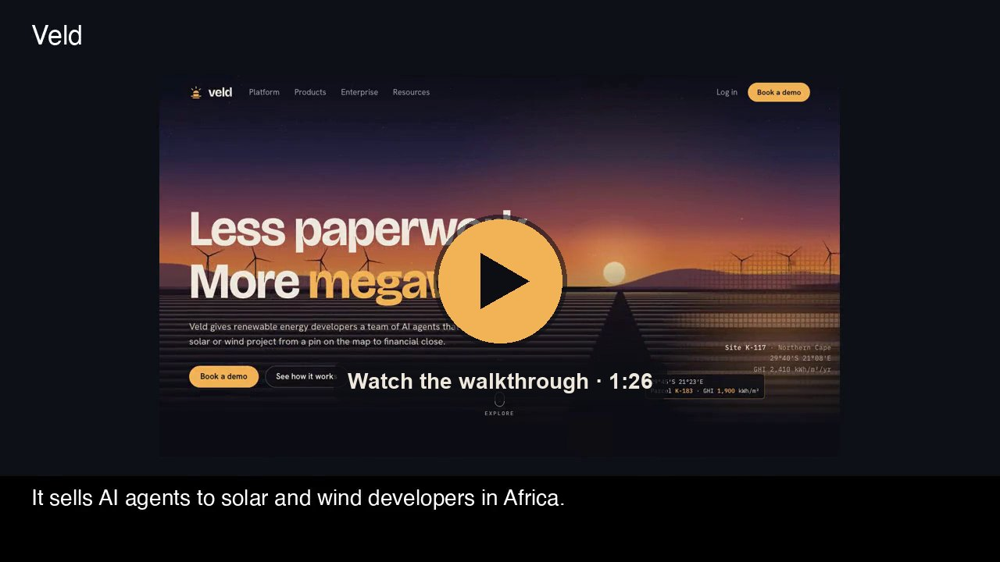
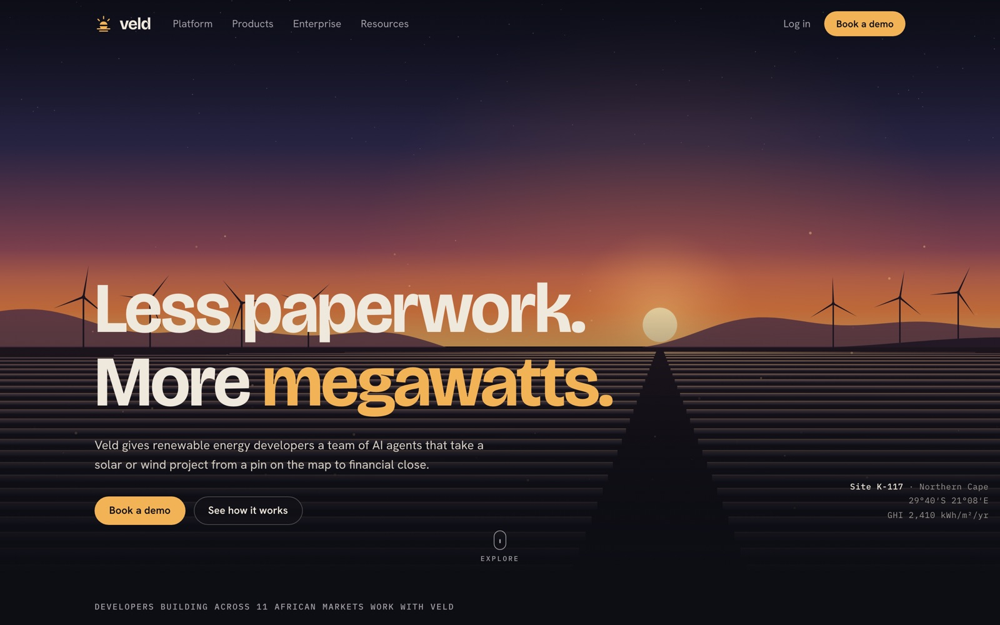
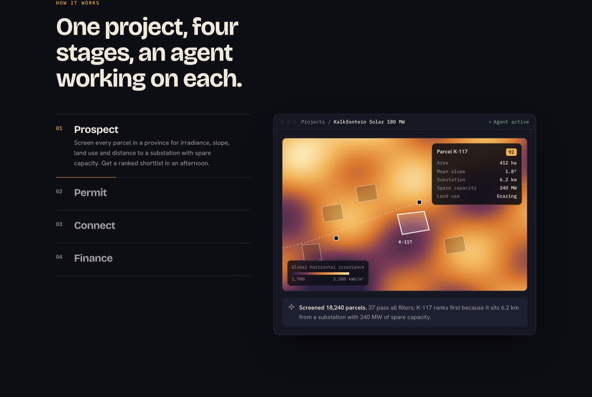
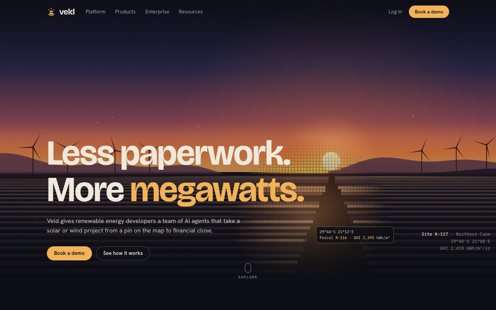
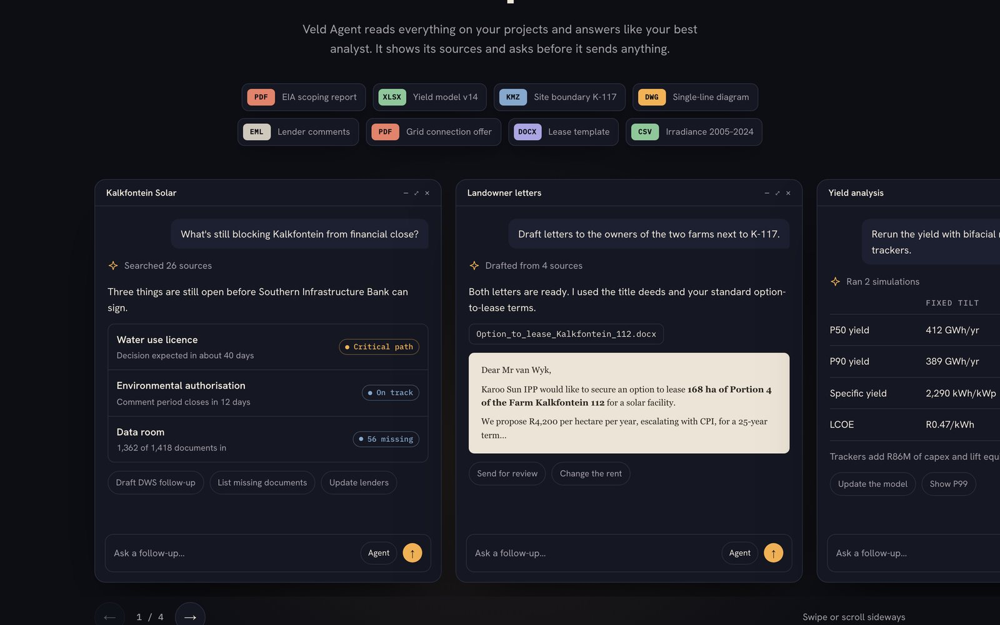
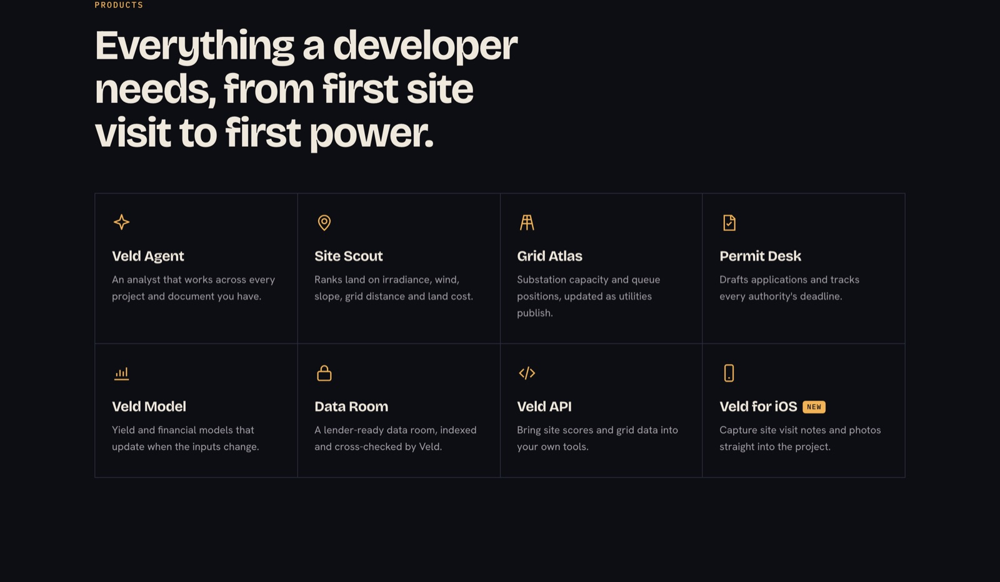
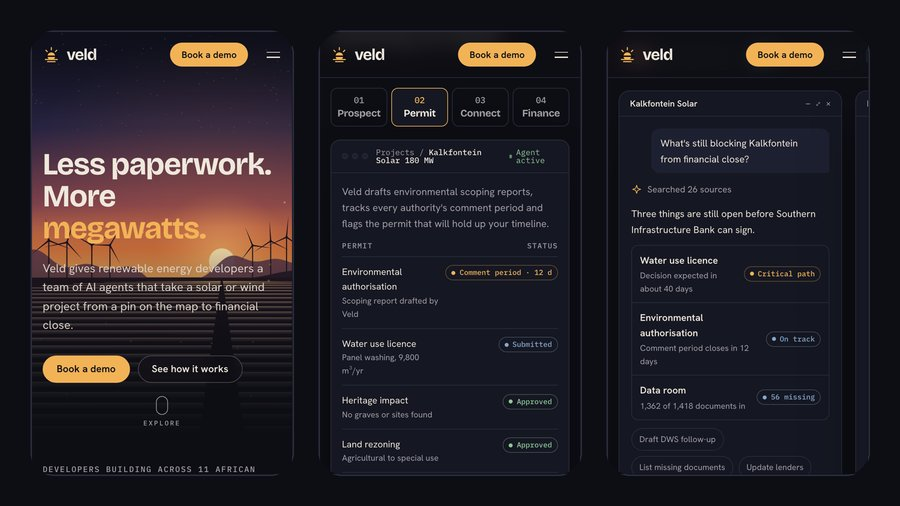

<div align="center">


# Veld

**Less paperwork. More megawatts.**

A landing page for a company that doesn't exist: an AI platform that takes African solar and wind projects from a pin on the map to financial close.

[**Live site**](https://veld-five.vercel.app) · [**Walkthrough video**](https://veld-five.vercel.app/docs/walkthrough.mp4) · [**Case study**](#the-brief)


<a href="https://veld-five.vercel.app/docs/walkthrough.mp4"></a>

<sub>An 86-second narrated tour of the site and the code behind it. Also in the repo as <a href="docs/walkthrough.mp4">docs/walkthrough.mp4</a>.</sub>

</div>

> [!NOTE]
> Veld is fictional. The company, customers, people, lenders and most numbers are invented for this project. The one real statistic is linked to its source.

|                     |                                                                                           |
| ------------------- | ----------------------------------------------------------------------------------------- |
| **Role**            | Concept, story, visual design, front-end build                                            |
| **Stack**           | One HTML file: plain CSS and JavaScript, Canvas 2D. No framework, no build step.          |
| **Inspired by**     | [lev.com](https://www.lev.com), a commercial real estate AI company                       |
| **Works on**        | Desktop and phone, keyboard, and reduced-motion settings                                  |

### Contents

[The brief](#the-brief) · [Finding the story](#finding-the-story) · [Design decisions](#design-decisions) · [Interaction](#interaction) · [On phones](#on-phones) · [Build](#build) · [How I checked it](#how-i-checked-it) · [What I'd do next](#what-id-do-next) · [Run it locally](#run-it-locally)

---

## The brief

I gave myself a brief: build a marketing site at the level of [lev.com](https://www.lev.com), but for a company I invent. Lev's site does a lot with very little. It has one strong headline over a cinematic image, one product story told in stages, then proof and a call to action. I wanted to see whether that structure could work for a different industry with its own visual identity, without copying Lev's look.

## Finding the story

Lev's pitch is "Do less work. Close more deals." The idea underneath is that AI agents handle the paperwork that slows a deal down.

I looked for an industry where that is just as true but more is at stake, and landed on utility-scale renewable energy in Africa. The [IEA's Africa Energy Outlook 2022](https://www.iea.org/reports/africa-energy-outlook-2022) puts it plainly: Africa has 60% of the world's best solar resources and only 1% of its installed solar capacity. What holds projects back is mostly not engineering. It's site studies, environmental permits, grid connection queues and lender data rooms, and each of these can take years.

That gave me the company, **Veld** (Afrikaans for open grassland), and the headline. The page tells the story in order:

1. **Hero:** the promise, set over the landscape the product works in.
2. **The gap:** the real 60% / 1% statistic, then the four delays developers live with.
3. **How it works:** one project, Kalkfontein Solar 180 MW, followed through Prospect, Permit, Connect and Finance.
4. **Veld Agent:** four example conversations about that same project.
5. **Products, results and a customer quote:** the proof.
6. **Enterprise:** security, for the lenders who will audit the work.
7. **Call to action:** "Your next 100 MW is already on the map."

## Design decisions



**Golden hour in the Karoo.** Lev opens on Manhattan at dusk. I wanted the same cinematic mood tied to Veld's subject, so the hero is a solar farm at sunset with wind turbines on the ridge. It's drawn in code on a canvas rather than taken from stock photography. That keeps the page light and sharp on any screen, and lets it move: the blades turn and dust drifts through the light.

**Palette.** Deep night blue for the background, warm off-white for text, and one accent: the amber of a low sun. The data colours in the product mocks (a dusty sky blue and a muted green) come from the same scene, so the app screens feel like part of the brand.

**Type.** Bricolage Grotesque for headlines, because it's tight and a little quirky at large sizes. Hanken Grotesk for body text. IBM Plex Mono for data, units and labels, where the page should feel like an instrument.

**Industry detail.** I wanted someone in solar development to recognise their own world. The mock screens use the field's real vocabulary and units:

- global horizontal irradiance in kWh/m²/yr
- substation capacity in MW
- P50 yield and LCOE in rand per kWh
- loan margins over JIBAR and minimum DSCR

The permit tracker uses South Africa's real authorities: DFFE, DWS, SAHRA and SACAA.



**Show the product instead of describing it.** "How it works" is a set of four tabs, and each opens a mock app screen for that stage:

| Stage        | What the screen shows                                                       |
| ------------ | --------------------------------------------------------------------------- |
| **Prospect** | An irradiance heat map with candidate land parcels, a power line and substations |
| **Permit**   | A permit tracker that flags the approval on the critical path              |
| **Connect**  | A bar chart of spare substation capacity, drawn to scale                   |
| **Finance**  | Headline model numbers and loan term sheets side by side                   |

Each screen ends with one line from the agent explaining what it did and why.

## Interaction

**A landscape you can prospect.** Lev's hero turns its footage into a grid of rounded tiles as you scroll. I adapted that to Veld's story: Veld sees land as parcels.

- Move the cursor over the scene and a lens breaks the land under it into parcel tiles.
- A readout follows the pointer with coordinates, a parcel number and an irradiance figure, calculated from the brightness of the tile you're over.
- The sky, hills and solar rows shift at different depths as you move.
- Scroll down and the whole scene tiles into parcels, and the corner caption changes to "Screening 18,240 parcels".

On a phone, tapping the scene shows the lens for a moment.



**Veld Agent, sideways.** The agent section opens with the project's files (EIA report, yield model, site boundary, single-line diagram). Below them is a row of conversations you swipe or click through sideways. The first one plays out as it comes into view: "Working", three steps ticking off, then the answer to what's still blocking financial close. The others cover landowner letters, a yield rerun with trackers, and the lender's checklist. Every number matches the rest of the page, so the permit, yield and lender details all describe the same project.

My first version told this as a pinned scroll story, like Lev's. In practice it meant scrolling down a long way just to move sideways between conversations, so I replaced it with a native sideways row. The vertical scroll stays a normal scroll.





## On phones



The phone layout was its own design pass, not just the desktop layout squeezed down:

- **Menu.** The nav links fold into a menu button that closes when you pick a link or press Escape.
- **Stage tabs.** The four stages become a compact row of buttons directly above the screen they control, so you see each change as you tap. Each screen carries its own short description.
- **Tables.** The permit table drops its Authority column so the status pills fit.
- **Hero.** The scroll-to-tiles effect is only on devices with a mouse. On a phone it would have run behind the intro text while you're trying to read it.
- **Lists.** Products become compact rows, and the agent's file chips scroll sideways like the conversations below them.
- **Tap targets.** Footer links and the row buttons are spaced for thumbs.

These changes cut about 2,000 px from the page's length on a phone.

## Build

The whole site is a single `index.html` of about 1,100 lines. I kept it dependency-free on purpose: it deploys anywhere as a static file and loads quickly.

- **Hero canvas.** The sky, ridges and solar rows are each drawn once to their own offscreen canvas. Every frame stacks them with a small offset for depth, then redraws only the turbine blades and dust. The animation pauses when the hero is off screen.
- **Parcel tiles.** Each frame, the scene is shrunk to one pixel per parcel, scaled back up with smoothing off, and covered with a repeating rounded-tile pattern. A low-resolution mask decides where tiles show: under the cursor, across the whole scene as you scroll, or both. The tiles sit on their own canvas above the darkening gradient, so the lens stays visible over dark ground.
- **Conversation row.** Native sideways scrolling with CSS scroll snap, so trackpads, touch and Shift-scroll all work. The arrow buttons step between the row's real stop positions, so quick repeated clicks keep moving instead of stalling. A counter announces the position to screen readers, and arrow keys work when the row has focus.
- **Accessible tabs.** The stage tabs follow the ARIA tabs pattern: arrow keys, Home and End all work, and focus moves with the selection.
- **Reduced motion.** If the device asks for reduced motion, the hero draws one still frame, auto-advance stops, and the agent's first answer appears straight away.

## How I checked it

- Rendered the page in headless Chromium at 1440 px desktop width and as an emulated iPhone 13.
- Clicked through all four stage tabs, the menu, and the conversation row on both sizes, including quick double clicks and both ends of the row.
- Moved the mouse across the hero to check the lens and readout.
- Ran the page with reduced motion turned on.
- Confirmed there were no console errors and the page never scrolls sideways on a phone.
- Fixed what the checks found:
  - The fixed navigation bar covered section headings after anchor links.
  - The cursor lens disappeared under the hero's darkening gradient.
  - On a phone, the stage tabs changed a screen you couldn't see, and the permit statuses were cut off.
  - The conversation counter stuck on the wrong number after quick clicks.

## What I'd do next

- Add a real demo-booking form with validation and a confirmation state.
- Add subpages for each product, using the same mock screens at full size.
- Run a Lighthouse pass and add Open Graph images, so the link previews well when shared.

## Run it locally

```bash
git clone https://github.com/Zubair-Elliot-17/veld
cd veld
open index.html
```

Nothing to install.
